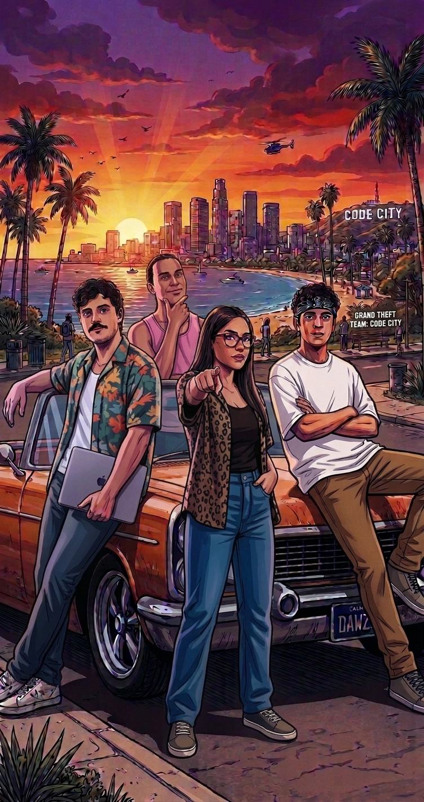
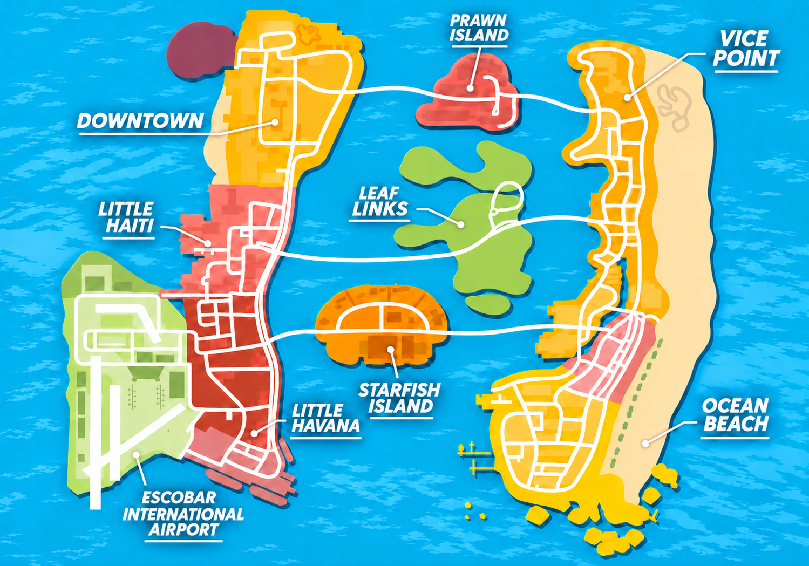

# Grand Theft Team: Code City


## Bienvenido a Code City

Bienvenido a nuestro Gaming Center. Aquí los gamemasters gestionan cada sala y cada módulo del local: quién llega, dónde se sienta y cuándo vuelve a quedar libre.

Entra, elige tu sala y empieza a jugar.



## Nuestras salas
 
Cada sala de Code City lleva el nombre de una zona del mapa de la ciudad. Estas mismas salas están cargadas en la base de datos.
 

 
| Tipo de sala | Salas |
|---|---|
| PC Standard (4) | Downtown, Little Haiti, Little Havana, Escobar International Airport |
| Simuladores/Consolas (3) | Leaf Links, Starfish Island, Ocean Beach |
| VIP (2) | Vice Point, Prawn Island |
 
Cada sala se divide en módulos de juego de distinto tamaño: **Solo** (1 puesto), **Duo** (2), **Squad** (5 puestos de PC) y **Party** (4 mandos).


## Funcionalidades
 
- Inicio y cierre de sesión de los gamemasters.
- Consulta de las salas, su capacidad y la disponibilidad de cada módulo.
- Ocupar un módulo cuando llega un cliente, comprobando que tenga capacidad suficiente.
- Liberar un módulo (solo el gamemaster que lo ocupó).
- Histórico de ocupaciones con filtros por sala y por módulo.
- Diseño responsive adaptado a móvil.

## Equipo y roles
 
| Integrante | Rol | Tareas |
|---|---|---|
| Pau | Coordinador | Ocupar y liberar módulos, filtros del histórico, conexión PDO, seguridad, README |
| David | Impulsor | Base de datos, vista de salas, estadísticas, exportar SQL |
| Nahuel | Finalizador | Datos de prueba, login/logout, detalle de sala, SweetAlerts, merge final |
| Alexandra | Portavoz | Guía de estilos, CSS general, responsive, histórico, presentación |
 
## Instalación y pruebas
 
1. Clonar el repositorio dentro de `www` de WAMP.
2. Abrir phpMyAdmin e importar el archivo `sql/db_pj5_gamingCenter.sql`.
3. Comprobar los datos de conexión en el archivo de conexión PDO.
4. Abrir `http://localhost/` seguido de la ruta del proyecto.
### Usuarios de prueba
 
Todos los gamemasters tienen la misma contraseña: `qweQWE123`.
 
| Usuario | Contraseña | Nombre |
|---|---|---|
| admin | qweQWE123 | Carlos Martínez |
| ninjaMaster | qweQWE123 | David García |
| pixelKing | qweQWE123 | Laura Fernández |
| gamePro | qweQWE123 | Javier López |
| shadowGM | qweQWE123 | Sergio Rodríguez |
| levelMaster | qweQWE123 | Ana Martínez |
 
## Estructura del proyecto
 
```
├── assets/
│   ├── images/
│   ├── scripts/ (main.js)
│   └── styles/  (header.css, style.css)
├── backend/  (liberar_modulo.php, logout.php, ocupar_modulo.php)
├── includes/  (header.php, session.php)
├── sql/  (conexion.php, db_pj5_gamingCenter.sql)
├── validaciones/  (validacion_login.js, validar_login.php)
├── views/  (historico.php, main.php)
├── index.php
└── README.md
```
 
## Organización del trabajo
 
- La planificación está en el archivo `Gantt.xlsx`, con las tareas, los responsables y el registro de los daily meetings:  [Excel del proyecto](https://docs.google.com/spreadsheets/d/19Ppj0Jhd4vAAdkHqJuHcli2SIUYos9fQNYcDNrTXZoI/edit?usp=sharing)
- El diseño previo se realizó en Figma: [Diseño en Figma](https://www.figma.com/design/hB93fuopu97sXgJor9hawv/Gaming-Center?node-id=159-418&t=1UDtYEnEws4saeCh-1).
- Cada integrante trabaja en su propia rama y se integra en `main` al final.

 